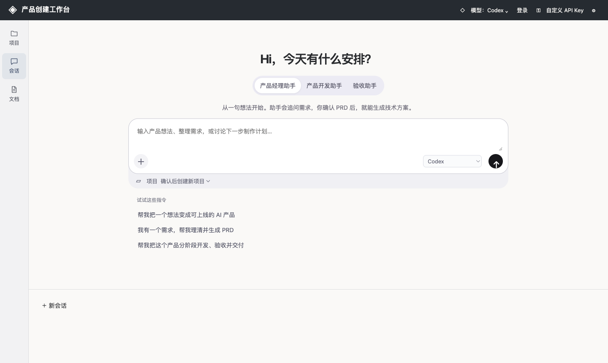
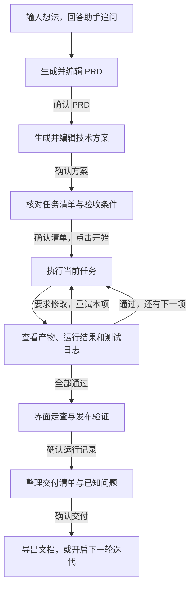
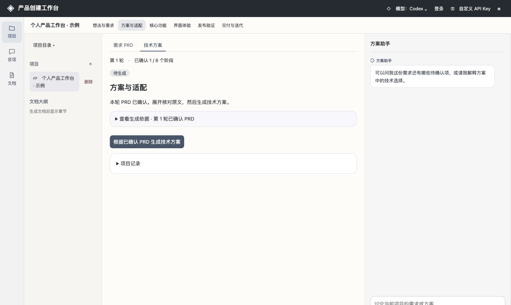

# 产品创建工作台

产品创建工作台是一个可以在自己电脑上运行的开源框架，提供 macOS 桌面 App 和本地浏览器界面。打开即可创建项目，无需注册工作台账号。你可以从一句想法开始，让助手追问需求，得到可编辑的产品需求文档（PRD）和技术方案，再按任务查看产物、运行结果和测试证据。每一步由你确认，项目进度保存在本机。

[下载 macOS 版（Apple Silicon）](https://github.com/Ethan101-Liu/product-creation-workbench/releases/tag/v0.1.1) · [从源码在本机启动](#从源码启动) · [免安装网页体验](https://ethan101-liu.github.io/product-creation-workbench/) · [使用流程](#使用流程)



## 选一种方式开始

| 使用方式 | 如何打开 | 项目和任务保存在哪里 |
| --- | --- | --- |
| macOS 桌面 App | 下载 DMG，拖入「应用程序」后打开 | 这台 Mac 的应用数据目录 |
| 本机源码版 | 克隆仓库，启动服务，用浏览器打开 `http://127.0.0.1:8876` | 当前浏览器的本地存储，开发产物写入本机项目目录 |
| 网页体验版 | 点击「免安装网页体验」 | 当前浏览器的本地存储 |

先建项目、写文档，需要 AI 时再选择模型。用 Codex 可以在本机授权自己的 ChatGPT 账号；用兼容模型可以直接接入自己的 API Key。换电脑或浏览器时，需要留存的已确认文档可在「文档」中导出。

## 使用流程

例如，输入「我想做一个离线茶叶库存本，可以新建批次，修改剩余克数」。在需求访谈里，可以把「新建 500 克，改成 350 克，退出重开后仍显示 350 克」写成验收条件。生成方案后，你可以逐段修改，再决定是否进入开发。



**会话**用于开始需求访谈。**项目**集中展示阶段、文档草稿和右侧方案助手，可以边看文档边提问。**文档**按项目列出已确认的版本，确认任一阶段后就能下载单份 Markdown，也可以下载合并文档。



## 免安装网页体验

无需注册，打开 [在线工作台](https://ethan101-liu.github.io/product-creation-workbench/)，输入产品想法即可开始。默认的「引导模式」会逐项提问，把你的回答整理成 PRD，并提供可编辑的方案和任务模板。用左侧「文档」可以下载已确认的版本。

要与真实模型对话，点「自定义 API Key」，选择服务商或填写兼容接口。浏览器会把 Key 和本次请求所需的内容直接发送到所选 HTTPS 服务商，接口需允许浏览器跨域请求（CORS）。Key 只在当前标签页的内存中保存，刷新后需重新接入。项目和会话保存在当前浏览器，清除网站数据会删除这些记录。

网页版支持记录开发结果与验收证据。本机 Codex 登录、自动执行代码与运行测试可在 macOS 桌面版中使用。

## 在 Mac 上开始

1. 从上方下载入口取得 v0.1.1 的 DMG，打开后将「产品创建工作台」拖入「应用程序」。此版本面向 macOS 14 及以上的 Apple Silicon Mac，使用本机临时签名，尚未完成 Apple 公证。系统可能会限制从互联网下载的应用首次启动。
2. 打开工作台，选择模型。使用 Codex 时，需要这台 Mac 上有可用的 Codex CLI。点「登录」可复用已有 ChatGPT 登录，首次使用可通过系统浏览器授权。使用其他服务时，点「自定义 API Key」，选择厂商和模型并输入 Key，也可以填写自己的 Chat Completions 兼容地址。
3. 点左侧「会话」，选择「产品经理助手」并输入想法。生成 PRD 后先核对并确认，再打开项目继续。已接入的模型也可以在对话输入框里切换。

模型请求会把本次对话所需的提问和项目上下文发送到所选服务。API Key 仅保存在当前服务进程的内存中，重启后需重新输入。桌面版的项目、会话及开发产物位于 `~/Library/Application Support/ProductWorkbench/`。浏览器版把项目与会话保存在当前浏览器，开发产物写入源码目录下的 `开发产物/`，两种工作区各自保存。

## 从源码启动

在 macOS 上准备 Git 和 Python 3.9 或更高版本，然后运行以下命令。递归克隆会一并取得需求访谈用到的上游模板。

```sh
git clone --recurse-submodules https://github.com/Ethan101-Liu/product-creation-workbench.git
cd product-creation-workbench
python3 prototype/server.py --open
```

浏览器会打开 `http://127.0.0.1:8876`。已经普通克隆的仓库可运行 `git submodule update --init --recursive` 补齐依赖。macOS 也可双击仓库中的「启动工作台.command」。

`prototype/` 包含界面、本机服务、模型连接与任务执行器。当前开发执行器支持 Python 标准库、SQLite 和 unittest，并使用 macOS 沙箱在临时副本上运行测试。界面走查、安装验证和交付记录可在项目中填写并确认。

`desktop/macOS/` 包含 Swift / WebKit 桌面外壳和打包脚本。二次开发者在 Apple Silicon Mac 上安装 Xcode Command Line Tools，并准备可重定位、静态链接的 arm64 CPython 3.12 运行时后，可执行以下命令重建 DMG。

```sh
python3 desktop/macOS/build.py /path/to/standalone-cpython-3.12
```

## 开源许可与致谢

工作台自身代码采用 [MIT License](LICENSE)。需求访谈使用 [Agent Workshop](https://github.com/hubooooooo/agent-workshop) 的提示词，分阶段推进和人工验收流程参考了 [Idea to Launch Kit](https://github.com/hubooooooo/idea-to-launch-kit)。两个上游项目分别保留原作者和许可，仓库通过 Git 子模块固定所用版本。
